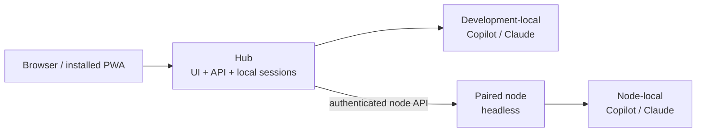
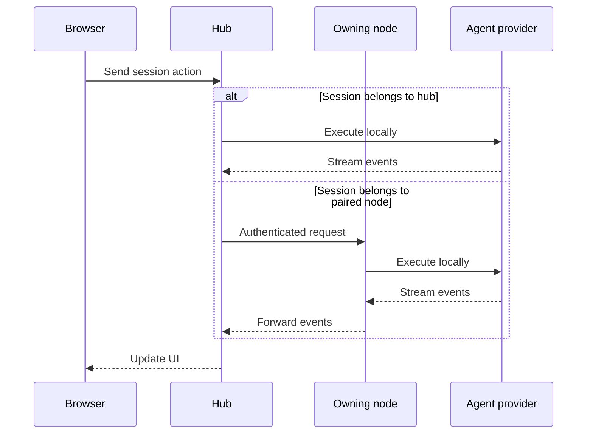
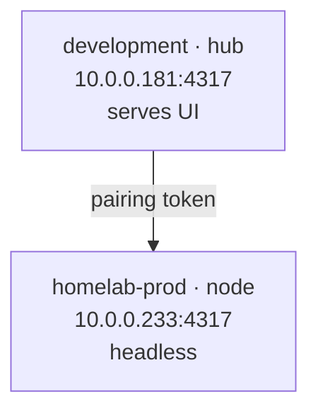

# Agentic Remote

A mobile-first web UI for supervising GitHub Copilot and Claude Agent sessions
on trusted computers.

## The important part

**A hub is one service that serves the UI and runs sessions on its own
computer.** LAN access does not require a second process.

Run this once on the computer that should host the UI:

```bash
./bin/agentic-remote setup \
  --role hub \
  --name development \
  --host 10.0.0.181 \
  --port 4317
```

This single command:

1. Installs dependencies and builds the app.
2. Creates an immutable release.
3. Installs and starts `agentic-remote.service`.
4. Serves the browser UI.
5. Runs development-local agent sessions.
6. Listens on `10.0.0.181:4317` for LAN access.

Open <http://10.0.0.181:4317/>.

`--role hub` enables the UI. `--host` only chooses the address to bind. They
are options for the same service, not separate setup steps.

## Architecture





The browser communicates only with the hub. Repositories, authentication,
processes, and provider history remain on the computer that owns each session.

## Requirements

- Linux with systemd user services
- Node.js 22+
- pnpm
- An installed and authenticated GitHub Copilot CLI
- tmux for terminal-backed Copilot sessions
- Optional: an installed and authenticated Claude Code CLI

Check providers before setup:

```bash
copilot
claude auth status   # only when Claude Agent support is wanted
```

Agentic Remote uses existing local provider authentication. It does not copy or
store GitHub, Copilot, or Claude credentials.

## Add another computer

A paired **node** runs sessions but does not serve the UI.

On the additional computer:

```bash
./bin/agentic-remote setup \
  --role node \
  --name homelab-prod \
  --host 10.0.0.233 \
  --port 4317

agentic-remote pair-info
```

Then open **Sessions → Manage computers** on the hub and enter the node URL and
pairing token.



## Providers

| Capability | GitHub Copilot | Claude Agent |
| --- | --- | --- |
| Streaming, queue, cancel, permissions, questions | Yes | Yes |
| Models and effort | Yes | Yes |
| tmux and SSH attachment | Yes | No |
| Native slash commands | Yes | Web commands only |
| External session discovery | Yes | Agentic Remote sessions only |
| Context management | Selectable where supported | Automatic |

Provider and execution-mode badges appear above each session name. Copilot
remains the default. Idle Copilot SDK sessions can be moved to tmux from the
session header. A session belongs to one provider; history is not transferred
between providers.

See [Provider compatibility](docs/provider-compatibility.md) for the complete
matrix.

## Use

- **New session**: choose computer, provider, and folder.
- **Open previous**: resume provider history known to Agentic Remote.
- **Queue**: add, edit, or remove prompts while an agent runs.
- **Stop**: cancel the active response.
- **Runtime**: configure supported model, effort, context, and mode options.
- **Session files**: browse, search, preview, and save Knowledge paths.
- **Paperclip / microphone**: upload supported files or transcribe audio.

Copilot sessions can be tmux-backed:

```bash
tmux attach
```

Claude Agent sessions are SDK-only.

## Service operations

```bash
agentic-remote status
agentic-remote logs
agentic-remote restart
agentic-remote update
agentic-remote rollback
agentic-remote uninstall
```

`setup` and `update` build an immutable release and restart the service.
`rollback` activates the previous release. Application data is preserved under
`~/.agentic-remote/`.

## Development

```bash
pnpm install
pnpm dev
```

The development server uses Vite plus Fastify. Run the complete checks with:

```bash
pnpm check
```

## Security

Agentic Remote is a trusted-administrator interface, not a multi-tenant
service. Protect the hub with TLS and a deny-by-default access layer. Do not
expose paired nodes publicly.

Pairing tokens, provider credentials, repositories, and session databases must
remain on their owning computers and outside Git.

## Documentation

- [Application specification](docs/app-spec.md) — normative product behavior
- [Multi-computer architecture](docs/architecture.md) — routing and ownership
- [Provider compatibility](docs/provider-compatibility.md) — Copilot/Claude
  differences

## Troubleshooting

```bash
agentic-remote status
agentic-remote logs
curl http://10.0.0.181:4317/api/health
```

If the installed PWA looks outdated, use **App settings → Check for updates**,
apply the update, and reopen the app.
