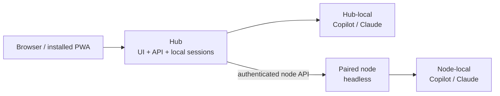
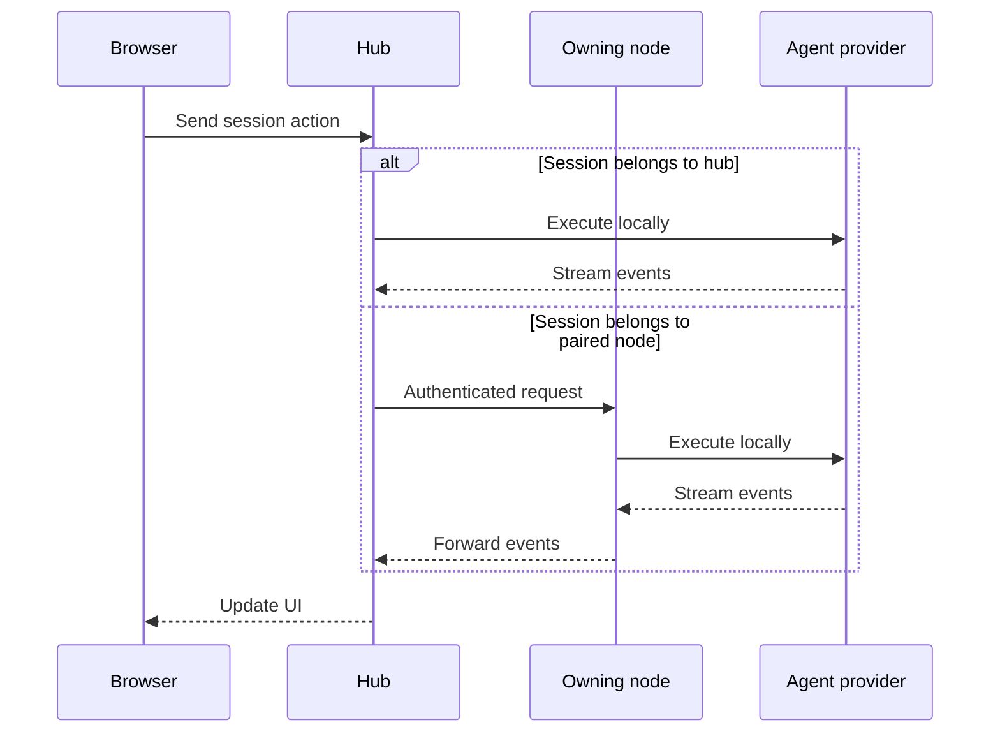
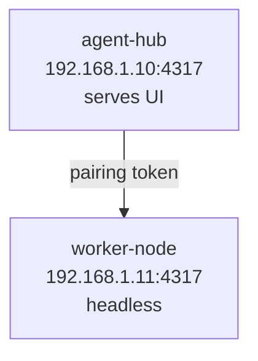

# Agentic Remote

A mobile-first web UI for supervising GitHub Copilot and Claude Agent sessions
on trusted computers.

## The important part

**A hub is one service that serves the UI and runs sessions on its own
computer.** LAN access does not require a second process.

Run this once on the computer that should host the UI:

```bash
./bin/agentic-remote setup \
  --role hub \
  --name agent-hub \
  --host 192.168.1.10 \
  --port 4317
```

This single command:

1. Installs dependencies and builds the app.
2. Creates an immutable release.
3. Installs and starts `agentic-remote.service`.
4. Serves the browser UI.
5. Runs development-local agent sessions.
6. Listens on `192.168.1.10:4317` for LAN access.

Open <http://192.168.1.10:4317/>.

`--role hub` enables the UI. `--host` only chooses the address to bind. They
are options for the same service, not separate setup steps.

## Architecture





The browser communicates only with the hub. Repositories, authentication,
processes, and provider history remain on the computer that owns each session.

### Explore the code graph

The maintained [Graphify folder](graphify/README.md) contains an offline
interactive graph, source-linked graph data, a report, and a reproducible
refresh command. Future agent sessions use it through the
`agentic-remote-navigation` skill.

```bash
python3 graphify/manage.py check
python3 graphify/manage.py query "KnowledgeRoot KnowledgeReader"
```

See the folder's setup instructions before the first CLI query. The graph
indexes tracked code locally; it does not send source to an external model.

## Requirements

- Linux with systemd user services
- Node.js 22.12+
- pnpm
- An installed and authenticated GitHub Copilot CLI
- tmux for terminal-backed Copilot sessions
- Optional: an installed and authenticated Claude Code CLI

Check providers before setup:

```bash
copilot
claude auth status   # only when Claude Agent support is wanted
```

Agentic Remote uses existing local provider authentication. It does not copy or
store GitHub, Copilot, or Claude credentials.

## Development and production separation

Keep the writable development checkout separate from the runtime that serves
the UI and accepts external connections. Build and test in development, then
promote the exact validated commit to a separate runtime source that publishes
an immutable release under `~/.config/agentic-remote/releases/current`.

`--role hub|node` describes the runtime topology; it does not select the
development or production channel. A machine-local, opt-in monitor may pull
`main`, run the configured validation, promote the exact
commit, restart the managed service, and verify recovery. The monitor and its
machine paths belong outside this repository so application development cannot
break the external access path.

See [Deployment and promotion](docs/deployment-promotion.md) for the profile
contract, promotion gates, rollback behavior, and post-merge cleanup rules.

For a reproducible setup on another machine:

```bash
./bin/agentic-remote-promotion-setup init
$EDITOR ~/.config/agentic-remote/promotion.env
./bin/agentic-remote-promotion-setup install --create-runtime --enable
```

The setup script copies the monitor and profile into machine-local paths. The
monitor is optional and disabled unless `--enable` is supplied. `enable` probes
the configured health URL first and refuses to arm the timer until it answers,
so a mistyped address fails before it can restart a service.

Existing installations can apply updated lifecycle definitions without
changing their profile or timer state:

```bash
./bin/agentic-remote-promotion-setup refresh
```

After that one-time refresh, successful promotions refresh the installed
monitor and units from the exact validated candidate before recording success.

To hold the current release, pause promotion with
`./bin/agentic-remote-promotion-setup disable --reason "…"`. The pause is a
durable marker the monitor enforces, so refreshes, updates, and a timer
rearmed by other tooling cannot resume it; only `enable` does. See
[Pausing promotion](docs/deployment-promotion.md#pausing-promotion).

### Promoting to a second machine

To keep the machine people use separate from the machine that rebuilds, add
downstream hosts to the same profile:

```text
AGENTIC_REMOTE_MONITOR_DOWNSTREAM_HOSTS=prod-host
AGENTIC_REMOTE_MONITOR_DOWNSTREAM_ROOT=/home/USER/src/agentic-remote
AGENTIC_REMOTE_MONITOR_DOWNSTREAM_HEALTH_URL=http://127.0.0.1:4317/health
```

After the local runtime proves a commit, each downstream host installs that
exact commit as a detached checkout, must land on it, and is health-checked with
the same readiness wait used locally. Any failure restores that host, and any
host already promoted in the same run, to the commit it was on, and leaves the
commit ungraduated so the next run retries.

This needs key-based SSH, a clean checkout that can fetch, and a build
toolchain on each host — no configuration, credentials, or state are copied
between machines. All destinations share one repository path and one health
URL, so machines that differ need their own profile. Downstream checkouts are
managed detached, so the monitor replaces `agentic-remote update` as the way
those hosts are updated.

Leave `DOWNSTREAM_HOSTS` empty for a single-machine setup.

## Add another computer

A paired **node** runs sessions but does not serve the UI.

On the additional computer:

```bash
./bin/agentic-remote setup \
  --role node \
  --name worker-node \
  --host 192.168.1.11 \
  --port 4317

agentic-remote pair-info
```

Then open **Sessions → Manage computers** on the hub and enter the node URL and
pairing token.



## Providers

| Capability | GitHub Copilot | Claude Agent |
| --- | --- | --- |
| Streaming, queue, cancel, permissions, questions | Yes | Yes |
| Background task monitoring | Yes, when the Copilot runtime advertises it | No |
| Models and effort | Yes | Yes |
| tmux and SSH attachment | Yes | No |
| Native slash commands | Yes | Web commands only |
| External session discovery | Yes | Agentic Remote sessions only |
| Context management | Selectable where supported | Automatic |

Provider and execution-mode badges appear above each session name. Copilot
remains the default. Idle Copilot SDK sessions can be moved to tmux from the
session header. A session belongs to one provider; history is not transferred
between providers.

See [Provider compatibility](docs/provider-compatibility.md) for the complete
matrix.

## Use

- **New session**: choose computer, provider, folder, and the configured provider
  default model and agent mode.
- **Open previous**: resume provider history known to Agentic Remote under the
  same session ID, including saved runtime settings and queued work.
- **Queue**: add, edit, or remove prompts while an agent runs.
- **Stop**: cancel the active response.
- **Ask**: use the header button or `/ask` (`/btw`) to ask a quick side question
  about a Copilot session. The thread docks above the message bar, which asks
  follow-ups until you go back to your message. The owning computer answers
  from the conversation without tools; nothing is sent to the session or saved,
  and an answer keeps coming while you work in another session.
- **Runtime**: configure supported model, effort, context, and mode options.
- **Background tasks**: inspect live task progress, output, errors, timestamps,
  and cancel supported tasks from the session header.
- **Skills / MCP servers**: use **Session actions** or `/skill`, `/skills`, and
  `/mcp` to inspect resource metadata without sending a prompt or changing
  configuration. Optional text after the command filters the list.
- **App settings**: configure separate default models and agent modes for
  Copilot and Claude.
- **Session files**: browse, search, preview, and save Knowledge paths.
- **Knowledge**: a per-session panel that docks beside the conversation or
  expands over it, with an in-place folder tree, remembered expansion and
  scroll position, breadcrumbs, and keyboard navigation.
- **Shortcuts**: `Alt+↓`/`Alt+↑` move between sessions, `Alt+K` opens or closes
  the knowledge panel, and `Alt+Shift+K` expands or minimizes it.
- **Paperclip / microphone**: upload supported files or transcribe audio.

Copilot sessions can be tmux-backed:

```bash
tmux attach
```

Claude Agent sessions are SDK-only.

Resource views distinguish live session reports, configured folder defaults,
and last-known metadata. Unsupported or not-yet-reported data is labelled
explicitly; opening the view never starts a provider turn just to inspect it.
MCP credentials, configuration values, URLs and raw connection errors are not
shown. See [Provider compatibility](docs/provider-compatibility.md) for the
provider-specific inspection boundaries.

## Service operations

```bash
agentic-remote status
agentic-remote logs
agentic-remote restart
agentic-remote update
agentic-remote rollback
agentic-remote uninstall
```

`setup` and `update` build an immutable release and restart the service.
`rollback` activates the previous release. Application data is preserved under
`~/.agentic-remote/`.

## Access through Microsoft Dev Tunnels

Microsoft Dev Tunnels can expose the hub through an authenticated HTTPS URL.
Its HTTP(S) and WebSocket forwarding supports the Agentic Remote UI, event
stream, and installable PWA.

Install and authenticate the Dev Tunnels CLI using Microsoft's current
[installation guide](https://learn.microsoft.com/azure/developer/dev-tunnels/get-started):

```bash
curl -sL https://aka.ms/DevTunnelCliInstall | bash
devtunnel user login -g
```

Start a private temporary tunnel for the hub:

```bash
devtunnel host -p 4317
```

Copy the printed `https://...devtunnels.ms` URL. In another terminal, configure
the hub to accept that exact browser origin and to listen on an interface the
local tunnel host can reach:

```bash
AGENTIC_REMOTE_ALLOWED_ORIGINS="https://TUNNEL-PORT.devtunnels.ms,http://localhost:4317" \
  ./bin/agentic-remote setup \
  --role hub \
  --name agent-hub \
  --host 0.0.0.0 \
  --port 4317
```

Replace `https://TUNNEL-PORT.devtunnels.ms` with the URL printed by
`devtunnel`. Open that URL, authenticate, and complete Microsoft's first-visit
anti-phishing confirmation. Keep the `devtunnel host` process running.

Temporary tunnel URLs change when restarted, so update
`AGENTIC_REMOTE_ALLOWED_ORIGINS` and rerun setup for the new URL. Create and
host a persistent named tunnel if a stable origin is needed.

> [!WARNING]
> Keep the tunnel private. Do not use `--allow-anonymous`: Agentic Remote is an
> administrator interface with no built-in user login. Dev Tunnels is currently
> a preview service without an SLA and is not recommended for production
> workloads.

## Development

```bash
pnpm install
pnpm dev
```

The development server uses Vite plus Fastify. Run the complete checks with:

```bash
pnpm check
```

After changing `src/app-icon-design.ts`, regenerate the committed PWA and
native bundle icons:

```bash
pnpm icons:pwa
pnpm --dir shell icons
```

## Security

Agentic Remote is a trusted-administrator interface, not a multi-tenant
service. Protect the hub with TLS and a deny-by-default access layer. Do not
expose paired nodes publicly.

**The hub has no built-in user login.** Host/Origin validation prevents browser
rebinding but is not authentication. Never expose the hub directly to the
internet; place every HTTP and WebSocket route behind an authenticated reverse
proxy or private encrypted network.

Pairing tokens, provider credentials, repositories, and session databases must
remain on their owning computers and outside Git.

Paired-node HTTP requests refuse redirects rather than replaying request bodies
or credentials to another endpoint. Configure the final node URL, including its
HTTPS scheme when applicable; a redirecting proxy is not a valid pairing endpoint.
Redirect failures return an explicit `502` message identifying the HTTP redirect
status and asking for the final node URL. The original node may already have
admitted an action before sending its redirect response, so check its state
before retrying; this gateway failure is not proof that the action was refused.

See [Security policy](SECURITY.md) before allowing other users to access a hub.

The hub validates the `Host` and `Origin` headers on every `/api/*` request so
a browser on the same network cannot reach it through DNS rebinding.
`agentic-remote setup` writes the hub's own address plus the loopback origins to
`AGENTIC_REMOTE_ALLOWED_ORIGINS` in the service environment file. When the hub
is reached through any other name — a reverse proxy, tunnel, or TLS hostname —
list every origin explicitly, comma separated, or those requests are rejected
with `403`:

```bash
AGENTIC_REMOTE_ALLOWED_ORIGINS=https://agents.example.com,http://192.168.1.10:4317 \
  ./bin/agentic-remote setup --role hub --name agent-hub --host 192.168.1.10 --port 4317
```

Setting the variable yourself replaces the derived list, so include every origin
you use, including `http://localhost:PORT` if you browse the hub locally. A
malformed entry fails at startup instead of being ignored. When the variable is
unset entirely, the hub falls back to its own `HOST:PORT` and allows loopback.

Sessions are confined to the user home directory, matching the folder browser.
Set `AGENTIC_REMOTE_ALLOWED_ROOTS` to a comma-separated list of absolute paths
to deliberately allow additional roots.

Audio transcription runs packaged `ffmpeg`/`ffprobe` binaries and verifies them
against known SHA-256 digests before use. A `503` mentioning packaged media
binaries means the digest did not match the table in
`server/transcription-service.ts` — expected after bumping `ffmpeg-static` or
`ffprobe-static`, and `pnpm test` reports the replacement digests.

### Transcribing on another computer

By default the hub transcribes audio itself and needs `whisper-cli` and a model.
Set `AGENTIC_REMOTE_TRANSCRIPTION_COMPUTER` to the name or id of a paired
computer to run transcription there instead:

```bash
AGENTIC_REMOTE_TRANSCRIPTION_COMPUTER=workstation
```

The hub streams the recording to that computer's authenticated node API and
keeps nothing on disk; only the transcript comes back. Sessions, uploads, and
Knowledge are unaffected, and naming the hub's own computer matches the default.

- Whisper and its model belong on the named computer, not the hub.
- `setup` reads the assignment back from the environment file it replaces, so it
  survives updates. Clear it by deleting the line and re-running setup.
- An unpaired or offline computer fails the recording with a `503`; one on a
  release without the endpoint reports a `409`.

### Oracle

The **Oracle** bubble at the bottom right of a conversation opens an agent
that knows every session and hands work to new sessions, which it names and
badges **Oracle**.

- **Ask | Delegate**: in **Ask**, Oracle reads your sessions and asks them side
  questions but never starts, messages, or stops one (`/oracle <question>` in
  a session asks the same way). **Delegate** lets it start and steer sessions.
- In **Delegate** it steers any session: it messages them, reopening closed or
  suspended ones, and answers their permission prompts (including folder trust)
  and questions so they carry on without you.
- Messages sent while it is busy wait in a queue where you can see, edit in
  place, and remove them.
- The microphone dictates to Oracle; the words land in its message bar.
- **App settings → Oracle** chooses its model and, per computer, the folder it
  starts sessions in. Both are kept on the hub; ask Oracle to start sessions
  somewhere else and it updates its folder.
- On a desktop, drag the panel's left edge to resize it.
- Its notes are in `~/.agentic-remote/manager/memory/`.

`setup` keeps these hub settings across updates (the names predate "Oracle"):

| Variable | Effect |
|---|---|
| `AGENTIC_REMOTE_MANAGER=off` | Turns Oracle off on this hub |
| `AGENTIC_REMOTE_MANAGER_MODEL` | Oracle's default model until one is chosen in App settings; Copilot's default when unset or unavailable |
| `AGENTIC_REMOTE_MANAGER_REASONING_EFFORT` | Effort for that default: `low`, `medium`, `high`, `xhigh`, or `max` |

## Documentation

- [Application specification](docs/app-spec.md) — normative product behavior
- [Multi-computer architecture](docs/architecture.md) — routing and ownership
- [Provider compatibility](docs/provider-compatibility.md) — Copilot/Claude
  differences
- [SDK and architecture roadmap](docs/sdk-architecture-roadmap.md) — proposed
  small-PR sequence, compatibility gates, and performance work
- [Native shell plan](docs/native-shell.md) — Tauri decision, alternatives,
  and the iPhone readiness gate
- [Background tasks](docs/background-tasks.md) — SDK review, UI gaps, and
  visual states
- [Slash command feedback](docs/slash-command-feedback.md) — what terminal-backed
  sessions report for each command
- [Security policy](SECURITY.md) — reporting and deployment boundaries

Agentic Remote is available under the [MIT License](LICENSE).

## Troubleshooting

```bash
agentic-remote status
agentic-remote logs
curl http://192.168.1.10:4317/api/health
```

The service runs provider startup, including session recovery, before it
listens, so a stalled startup refuses connections; only recovery deferred by
indeterminate terminal discovery is retried after listening. Each phase logs
one JSON line when it begins, such as
`{"startupPhase":"copilot.discovery","event":"begin","elapsedMs":812}`, and one
`complete` or `fail` line with `durationMs`. Failures name only the error class
and any constant-style code, such as `EADDRINUSE`. `elapsedMs` is monotonic
time since the process started. Phases run in order: `app.build`;
`service.start`, containing `copilot.start` (`copilot.store`, `copilot.sdk`,
`copilot.models`, `copilot.discovery`, `copilot.recovery` with its
`copilot.recovery.*` steps, `copilot.queue.*`) and `claude.start`
(`claude.store`, `claude.availability`, `claude.queue`); then `fastify.listen`,
which includes a hub's `manager.start`. The last `begin` without its own
`complete` or `fail` names the stalled phase:
`journalctl --user --unit agentic-remote --grep startupPhase`.

If the installed PWA looks outdated, use **App settings → Check for updates**,
apply the update, and reopen the app.

An iPhone or iPad captures its launcher icon and standalone status-bar mode
when the app is added to the Home Screen. To adopt a shipped launcher-icon
change or full-height Dynamic Island behavior, remove the existing Home Screen
app and add it again from Safari. Agentic Remote loads its manifest with
credentials and uses new opaque Relay icon URLs there; it deliberately omits
Apple-touch declarations and root fallbacks so Safari cannot prefer a failed
legacy icon request and generate a letter tile.
