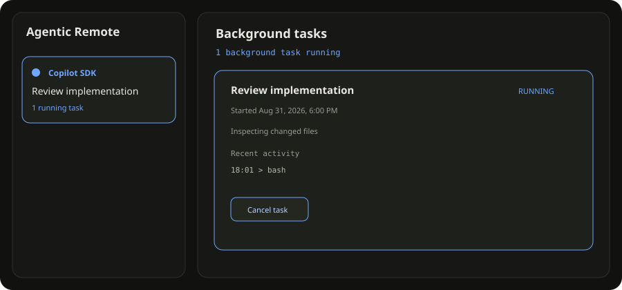
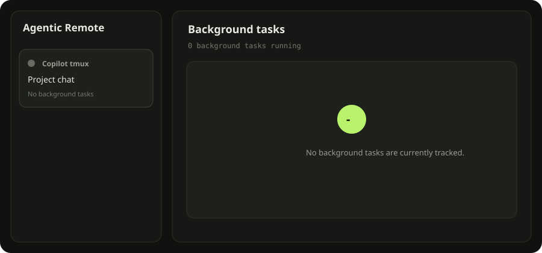
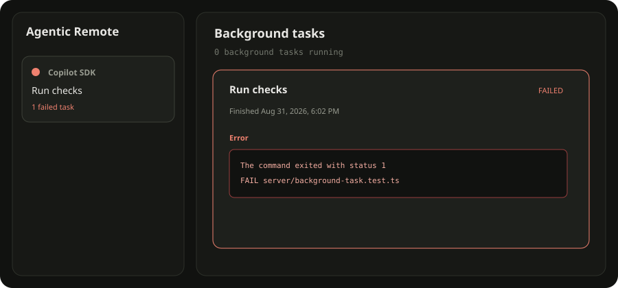

# Background tasks

Status: implemented for Copilot SDK and tmux sessions, 2026-08-31

Agentic Remote treats background work as state owned by the session's
computer. The browser receives task snapshots from the hub, and the hub routes
task reads and cancellation to the node that owns the session. Task state is
kept in a separate in-memory tracker rather than being mixed into the
conversation transcript or persisted session state.

## SDK and release review

The pinned `@github/copilot-sdk` version is 1.0.11. Its experimental
session-scoped task RPC exposes:

| SDK surface | Agentic Remote use |
| --- | --- |
| `session.rpc.tasks.list()` | Read agent and shell task metadata |
| `session.rpc.tasks.refresh()` | Refresh detached-shell state before listing |
| `session.rpc.tasks.getProgress({ id })` | Read recent agent activity or shell output |
| `session.rpc.tasks.cancel({ id })` | Cancel a running or waiting task |
| `session.background_tasks_changed` | Invalidate the local snapshot and list again |

At this review point, SDK 1.0.11 is the latest stable SDK. The lockfile's
bundled Copilot runtime is 1.0.80, while the latest stable CLI release is
1.0.82; the preview SDK release does not replace the task RPC. This feature
uses the pinned stable API and leaves runtime upgrades as a separate,
rollbackable release change.

The SDK status is `running`, `idle`, `completed`, `failed`, or `cancelled`.
The UI contract includes the requested `queued` state by presenting SDK
`idle` tasks as queued/waiting. The SDK change event is ephemeral and carries
no task data, so snapshots are listed again after a session is attached and
after a hub/node reconnect. Task output is bounded to 20,000 characters,
activity is bounded to 40 lines, and at most 100 tasks are retained in one
snapshot.

tmux-backed sessions are owned by the interactive Copilot CLI process and
cannot safely be resumed through the SDK task RPC. Their monitor mirrors the
CLI `/tasks` event-log projection: root `task` invocations and subagent
lifecycle events provide agent tasks, while attached or detached shell starts,
background handoffs, shell-exit metadata, completion notifications, and tool
telemetry provide shell tasks. Shell records use the CLI `/tasks` default of
background execution when the runtime omits an explicit mode. This keeps shell
work visible without attaching a second owner to the session.

The current Copilot CLI release review found these relevant UI features:

| CLI release | Feature relevant to the `/tasks` parity target |
| --- | --- |
| [1.0.60](https://github.com/github/copilot-cli/releases/tag/v1.0.60) | Follow-up prompts to background agents |
| [1.0.62](https://github.com/github/copilot-cli/releases/tag/v1.0.62) | Promoted shells continue after the foreground turn |
| [1.0.71](https://github.com/github/copilot-cli/releases/tag/v1.0.71) | Finished-shell output remains available in task details |
| [1.0.74](https://github.com/github/copilot-cli/releases/tag/v1.0.74) | Correct prompt/response ordering after reopening tasks |
| [1.0.79](https://github.com/github/copilot-cli/releases/tag/v1.0.79) | Nested task trees, current/all and finished filters, live steering |
| [1.0.81](https://github.com/github/copilot-cli/releases/tag/v1.0.81) | Complete history across repeated `read_agent` calls |

Sources:

- [Copilot SDK releases](https://github.com/github/copilot-sdk/releases)
- [Copilot CLI releases](https://github.com/github/copilot-cli/releases)
- [SDK task RPC definitions](https://github.com/github/copilot-sdk/blob/main/nodejs/src/generated/rpc.ts)
- [SDK session events](https://github.com/github/copilot-sdk/blob/main/nodejs/src/generated/session-events.ts)

## Deliberate UI gaps

- The upstream task RPC is experimental and the change event is an
  invalidation signal, not a durable event stream. Agentic Remote therefore
  resynchronizes instead of trusting event counts.
- CLI task trees and follow-up steering are not exposed in this slice. Task
  details show the available prompt, result, timestamps, progress, output, and
  error, with cancellation where the SDK supports it.
- A tmux-backed session cannot be attached to the SDK task RPC without
  transferring provider ownership. Terminal sessions use the persisted
  `/tasks` event projection for agent and detached-shell history and
  explicitly disable per-task cancellation because the terminal controller
  does not own the detached process.
- Claude Agent sessions remain SDK-only and do not advertise Copilot background
  tasks.

## Visual review states

The implementation was reviewed against these required states:

