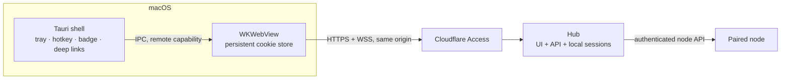

# Desktop app plan

Status: Phases 1 and 2 implemented, not yet run against a hub on a real desktop

This document records the architecture decision for a native desktop
application that supervises Agentic Remote sessions, and the phased plan to
build it. macOS is the driving target; Windows and Linux build from the same
source.

`docs/app-spec.md` remains normative for product behavior. This document adds
the desktop surface and MUST NOT contradict it.

## 1. Goal

Give the hub a first-class macOS client that opens directly to the user's
sessions, instead of a Safari tab pointed at the public hostname. The desktop
app exists to add integrations the browser cannot offer, not to become a second
implementation of the UI.

The desktop app MUST:

- Open to the configured hub URL with no address bar and no tab strip.
- Reuse the existing React UI rather than reimplementing it.
- Add macOS integrations the web app cannot reach: menu-bar presence, Dock
  badge, global hotkey, notification actions, deep links, and launch at login.
- Stay version-coupled to the hub it connects to.

The desktop app MUST NOT:

- Fork the UI, duplicate `shared/contracts.ts`, or hold its own session state.
- Store provider credentials, pairing tokens, or repository content.
- Become a second hub.

## 2. Decision summary

| Question | Decision |
| --- | --- |
| New repository? | **No.** A `desktop/` package inside this repository. |
| Shell technology | **Tauri v2**, loading the hub over HTTPS. |
| Platforms | **Cross-platform.** macOS is the driving target; Windows and Linux build from the same source and are covered by CI. |
| UI source | The **remote hub**, not a bundled copy. |
| Immediate stopgap | Safari **Add to Dock** while the shell is built. |

### 2.1 Why not a new repository

The desktop app is another client of the same behavior contract, not a separate
product. Keeping it here means:

- **Version coupling is already a contract.** `docs/app-spec.md` §12 makes the
  deployed package version the source of truth and requires the client to
  detect a release through `/api/version`. A separate repository would have to
  re-derive that coupling across a repository boundary.
- **One specification.** A desktop regression is an app-spec regression, and
  §16's acceptance matrix should grow desktop rows rather than fork.
- **Existing workflow.** Issues, PR review, CI, release publication, and
  rollback tooling already live here.
- **Shared assets.** Icons in `public/icons`, `shared/contracts.ts`, and the
  bridge module in `src/` are consumed directly.

The one real cost is keeping desktop dependencies out of the Linux service
install. This repository is a single package, not a pnpm workspace, so
`desktop/` carries its own `package.json` and lockfile and is not referenced by
the root manifest. `bin/agentic-remote setup`, `pnpm install`, and release
publication therefore never see Tauri, Rust, or any macOS tooling. CI keeps the
existing `ubuntu-latest` job untouched and adds a separate `macos` job that runs
only when `desktop/**` changes.

### 2.2 Why the shell loads the remote URL

Two shapes were considered:

- **A. Remote-URL shell** — the webview navigates to `https://<hub>` and the
  hub serves the UI exactly as it does for Safari today.
- **B. Locally bundled UI** — the app ships `dist/` and calls the hub's API
  cross-origin.

**Option A is the decision.** Option B was rejected because it breaks the hub's
security model and creates permanent dual-surface maintenance. Measured against
the development hub:

| Request | Result |
| --- | --- |
| `GET /api/health`, no `Origin` (native client) | `200` |
| `GET /api/health`, `Origin: https://<hub>` (same origin) | `200` |
| `GET /api/health`, `Origin: tauri://localhost` | `403` |
| `GET /api/health`, `Origin: http://localhost:1420` | `403` |
| `GET /api/health`, `Origin: file://` | `403` |
| Any of the above | no `Access-Control-*` response headers |

`originPolicy` in `server/hub-routes.ts` fails closed on the hub's own origin
specifically to defeat DNS rebinding, and the hub emits no CORS headers at all.
Option B would require relaxing that allowlist for a webview origin, adding CORS
to a control plane that currently has none, and additionally changing
`src/api.ts` (relative `fetch` paths) and `src/App.tsx:4852` (WebSocket URL
built from `window.location`) to accept a configurable base URL.

Option A needs **no server change**. Because the webview is same-origin with the
hub, the origin policy, the `/api/events` WebSocket, the Cloudflare Access
cookie, relative fetches, the service worker, and the §12 update flow all behave
exactly as they already do in Safari.

### 2.3 Why Tauri rather than Electron

| | Tauri v2 | Electron |
| --- | --- | --- |
| Bundle | ~3–6 MB | ~90–150 MB |
| Idle memory | ~30–50 MB | ~150–300 MB |
| Engine | System WKWebView | Bundled Chromium |
| Self-hosted auto-update | Own ed25519 keys | Squirrel.Mac, **requires Apple code signing** |
| Apple Developer Program for updates | Not required | Required ($99/yr) |
| Toolchain | Rust + Node | Node only |

Two factors decide it:

1. **Auto-update without an Apple Developer Program.** Tauri's updater signs
   with a keypair generated by `tauri signer generate`. Electron's Squirrel.Mac
   updater only works on a code-signed app. For a self-hosted single-user tool,
   Tauri removes a recurring paid dependency from the release path.
2. **WKWebView is the engine the PWA already targets.** The mobile-first CSS,
   safe-area handling, and viewport work in `src/index.css` were written and
   validated against WebKit. Electron would introduce a second rendering engine
   to regress against for no benefit.

The cost is a Rust toolchain. It is bounded: the Rust in this design is window,
tray, and updater setup. All feature logic stays in TypeScript, called from the
existing React app through `@tauri-apps/api`.

Rejected alternatives: **Electron** (size and the signing requirement above);
**Swift/SwiftUI** (lightest, but macOS-only, needs Sparkle for updates and a
third-party package for global hotkeys, and puts app logic in a third language);
**Nativefier** (unmaintained wrapper, no controlled update path).

### 2.4 Safari "Add to Dock" as the stopgap and the baseline

macOS has supported Add to Dock since Sonoma. It costs nothing to adopt today
and already provides a standalone window, Web Push, Dock badging, launch at
login, and persistent cookies, and the Cloudflare Access flow works normally in
its isolated WebKit store.

It cannot provide a menu-bar item, a global hotkey, deep links, notification
actions, or silent background refresh. Those are exactly the integrations that
justify the native shell.

**Adopt Add to Dock now.** It is the honest baseline: any phase of the desktop
app that does not clearly beat it is not worth shipping.

## 3. Architecture



The shell owns the window and the OS surface. The webview owns everything the
browser already owns. The bridge between them is a small, explicitly
permissioned IPC channel.

### 3.1 Remote capability and its security boundary

Tauri v2 disables IPC for remote content by default. Granting it requires a
capability naming the exact origins.

A static capability file cannot express this, because the hub address belongs to
the machine rather than to the binary. The shell therefore builds the capability
at runtime from the stored configuration, using Tauri's `dynamic-acl` feature:

```rust
let mut capability = tauri::ipc::CapabilityBuilder::new("hub-remote")
    .local(false)
    .window("main");
for origin in configured_origins {
    capability = capability.remote(origin);
}
app.add_capability(capability)?;
```

This is the security-critical code in the design.

- The origin list MUST come from validated configuration. Wildcards MUST NOT be
  used.
- Only `http` and `https` hub URLs are accepted, and each is reduced to a bare
  scheme-plus-authority origin before it is granted.
- Filesystem, shell, and process permissions MUST NOT be granted to a remote
  origin.
- `local(false)` keeps this capability off the locally served settings window,
  which has its own separate capability.
- The minimum Tauri version MUST be at or above the fix for CVE-2024-35222, in
  which remote-origin iframes could reach IPC without permission. The shell
  pins Tauri 2.11 or later.

Because the hub is a trusted-admin control plane behind Cloudflare Access, the
threat model is a compromised or spoofed hub response, which is why the origin
list and permission list stay minimal.

Traffic in the other direction needs no capability at all: the shell delivers
native events by evaluating a single `__emit` call in the page. Only web-to-
native calls cross the IPC boundary.

### 3.2 Progressive enhancement in the web app

The web app stays a browser app. A new `src/desktop.ts` detects the shell and
enables extra behavior only when present:

```ts
export function desktopShell(): boolean {
  return '__TAURI_INTERNALS__' in window
}
```

- In Safari and on iPhone, nothing changes.
- In the shell, the app additionally reports the count of sessions awaiting
  input for the badge, routes notifications through the shell instead of Web
  Push, and handles deep-link navigation events.
- Every desktop feature MUST degrade silently. A hub opened in a browser MUST
  NOT show controls that only the shell can satisfy.

### 3.3 Authentication

The webview performs the ordinary Cloudflare Access redirect. The hub's Access
application currently offers Azure, GitHub, and email one-time PIN; the
redirect-based flow works inside WKWebView, and one-time PIN is a guaranteed
fallback if an identity provider refuses an embedded webview.

`CF_Authorization` is `HttpOnly`, `Secure`, `SameSite=Lax`, and scoped to the
hub hostname. Two consequences matter:

- It is sent on the `/api/events` WebSocket upgrade **because the socket is the
  same origin as the page**. This is another reason the UI must not be served
  from a local origin.
- It persists across app restarts only while the Access session policy sets an
  expiry. If the Zero Trust session is configured as session-only, the user
  re-authenticates on each launch. **Verify the configured session duration
  before shipping**, and raise it if re-login proves annoying.

Service tokens (`CF-Access-Client-Id` / `CF-Access-Client-Secret`) are
explicitly **out of scope for the webview**: a webview does not attach custom
headers to its own requests. They MAY later be used from the Rust layer for
background polling that runs while no window is open. If adopted, the token is a
credential and MUST live in the macOS Keychain, never in Git, in
`tauri.conf.json`, or in a bundled file.

### 3.4 Hub selection and LAN fallback

The hub URL MUST be user-configurable and MUST NOT be hard-coded in the
repository, matching the existing rule that host topology belongs to a
machine-local profile. The first launch opens a settings window, stores the URL
in the platform config directory, and accepts an optional direct address used
when the public hostname is unreachable — which also keeps the app working when
Cloudflare or the tunnel is down.

Switching hubs destroys the previous window and re-grants the capability so one
hub's IPC grant is never presented to another. Clearing the webview cookie store
for the previous host is not implemented yet; until it is, switching between
hubs leaves the old Access cookie in the shared store.

## 4. Native integrations

Ordered by value over the Add-to-Dock baseline.

| # | Integration | Why it beats the browser | Status |
| --- | --- | --- | --- |
| 1 | **Native notifications from the live event stream** | An embedded webview has no Web Push, so the shell raises notifications itself from the session WebSocket. Clicking one opens that session. | Implemented |
| 2 | **Notification actions** — approve/deny a permission from the notification | `docs/app-spec.md` §5 makes questions and permissions the top-priority state, so acting without focusing the app is the biggest possible win. | **Deferred, see below** |
| 3 | **Tray / menu-bar item** | Passive supervision without a window. Impossible in any PWA. | Implemented |
| 4 | **Badge** — sessions awaiting input, on dock, taskbar, or launcher | The shell drives it from the event stream rather than from notification permission. | Implemented |
| 5 | **Global hotkey** — summon or hide the window | Removes app-switching from the supervision loop. | Implemented |
| 6 | **Deep links** — `agentic://computer/<id>/session/<id>` | Lets notifications, terminals, and scripts open an exact session. | Implemented |
| 7 | **Launch at login, start hidden** | The app is a monitor; it should already be running. | Planned |
| 8 | **Window state** — restore size, position, and sidebar width | Complements the existing resizable-sidebar work. | Planned |
| 9 | **Always-on-top mini monitor** | A compact status window over other work. | Optional |

### 4.1 Why notification actions are deferred

This was expected to be the headline feature and it does not work as assumed.
On desktop, `tauri-plugin-notification` delegates to `notify-rust`, which cannot
register the notification categories macOS requires for inline action buttons;
the plugin's action-type registration is mobile-only. Delivering it needs a
direct `UNUserNotificationCenter` implementation in the shell.

The bridge was designed for this anyway. `src/desktop.ts` already sends
`actions` and exposes an `onNotificationReply` channel, and the shell already
accepts and ignores them, so the capability can be added entirely inside the
shell without touching the web app.

Until then, a notification opens the session, which still beats the browser
because the shell can notify at all without Web Push.

## 5. Release and distribution

- Bundles cannot be cross-compiled. Each platform builds itself, so CI runs a
  `desktop` job on `macos-latest`, `ubuntu-latest`, and `windows-latest`. The
  Linux service hosts never build the desktop app.
- The desktop shell is a separate package with its own `package.json` and
  lockfile, so the existing `pnpm check` job and the service install are
  unaffected by it.
- Bundle icons are generated from `public/icons/icon-512.png` by `pnpm icons`
  rather than committed, so there is one icon source in the repository.
- Updates use the Tauri updater against a self-hosted JSON manifest, signed with
  a repository-independent ed25519 key. The **private updater key is a secret**:
  it lives in GitHub Actions secrets and MUST NOT be committed.
- Without Apple notarization, Gatekeeper requires a manual first-open approval.
  That is acceptable for a single-user install. Notarization can be added later
  without changing the architecture, because Tauri's updater does not depend on
  it.
- The desktop version MUST track the app version already used by `/api/version`
  so a shell and hub mismatch is visible.
- The shell MUST tolerate a hub that is newer than itself: the UI comes from the
  hub, so only the native bridge can go stale. Bridge calls MUST be
  feature-detected rather than assumed.

## 6. Phases

Each phase is independently shippable and independently abandonable.

| Phase | Scope | Exit criterion | Status |
| --- | --- | --- | --- |
| **0** | Adopt Safari Add to Dock. No code. | Sessions supervised from a Dock icon; baseline understood. | Available now |
| **1** | `desktop/` package. Tauri shell, configurable hub URL, runtime remote capability, settings window, persistent cookies. | App opens to the hub, Access login survives a restart, sessions stream over WSS. | Implemented, needs a first run on a real desktop |
| **2** | `src/desktop.ts` bridge, badge, native notifications, tray, global shortcut, deep links. | Waiting-session count visible from the badge; `agentic://` opens the right session. | Implemented |
| **3** | Notification action buttons via `UNUserNotificationCenter` (§4.1). | A permission is resolved from the notification without focusing the app. | Deferred |
| **4** | Launch at login, start hidden, window-state restore, self-hosted updater. | The app is already running and restores where it was. | Planned |
| **5** | Optional: mini monitor, Keychain service token for background polling. | — | Optional |

Phases 1 and 2 are code-complete and pass CI on all three platforms, but neither
has been exercised against a hub on a real desktop yet. That first run is the
remaining risk and should happen before any further phase starts.

## 7. Open questions

1. What Cloudflare Access session duration is configured? This decides whether
   the app re-authenticates on every launch (§3.3).
2. Does the configured identity provider allow an embedded webview, or is email
   one-time PIN the practical path?
3. ~~macOS-only or cross-platform?~~ **Resolved: cross-platform.** Tauri builds
   all three targets from the same source and CI covers them, so restricting to
   macOS would have cost effort rather than saved it.
4. Is Gatekeeper's manual first-open acceptable indefinitely, or is
   notarization wanted before daily use?

## 8. Impact on existing contracts

- `docs/app-spec.md` gains a desktop section and desktop rows in the §16
  acceptance matrix once the shell has been exercised against a real hub.
- `docs/architecture.md` is unchanged: the desktop app is a client of the hub,
  not a new role. It is neither a hub nor a node and owns no sessions.
- `server/` is unchanged. This is a deliberate property of the design, and any
  proposal that requires a server change should be re-examined against §2.2.
- `src/desktop.ts` is the contract between the web app and the shell. It and
  `desktop/src-tauri/src/bridge.rs` MUST change together, and every method MUST
  stay optional on the web side so a browser and an older shell both degrade
  cleanly.
