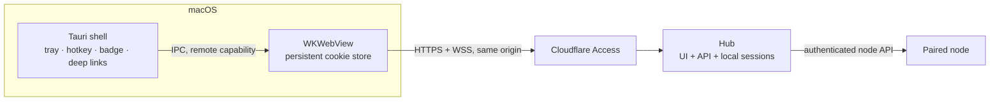

# Native shell plan

Status: Desktop implemented and building locally; iOS structured and
compiling, not yet run on a device

This document records the architecture decision for the native applications
that supervise Agentic Remote sessions, and the phased plan to build them. One
Tauri project targets macOS, iOS, Windows, and Linux. macOS and iOS are the
driving targets.

`docs/app-spec.md` remains normative for product behavior. This document adds
the native surface and MUST NOT contradict it.

## 1. Goal

Give the hub first-class macOS and iOS clients that open directly to the user's
sessions, instead of a Safari tab pointed at the public hostname. The native
apps exist to add integrations the browser cannot offer, not to become a second
implementation of the UI.

The shell MUST:

- Open to the configured hub URL with no address bar and no tab strip.
- Reuse the existing React UI rather than reimplementing it.
- Add integrations the web app cannot reach: badge, notifications, deep links,
  and on desktop a menu-bar presence and global hotkey.
- Stay version-coupled to the hub it connects to.

The shell MUST NOT:

- Fork the UI, duplicate `shared/contracts.ts`, or hold its own session state.
- Store provider credentials, pairing tokens, or repository content.
- Become a second hub.

## 2. Decision summary

| Question | Decision |
| --- | --- |
| New repository? | **No.** A `shell/` package inside this repository. |
| Shell technology | **Tauri v2**, loading the hub over HTTPS. |
| Platforms | **macOS, iOS, Windows, Linux from one `src-tauri`.** macOS and iOS are the driving targets. |
| UI source | The **remote hub**, not a bundled copy. |
| Immediate stopgap | Safari **Add to Dock** and the existing iPhone PWA. |

### 2.1 Why not a new repository

The shell is another client of the same behavior contract, not a separate
product. Keeping it here means:

- **Version coupling is already a contract.** `docs/app-spec.md` §12 makes the
  deployed package version the source of truth and requires the client to
  detect a release through `/api/version`. A separate repository would have to
  re-derive that coupling across a repository boundary.
- **One specification.** A desktop regression is an app-spec regression, and
  §16's acceptance matrix should grow desktop rows rather than fork.
- **Existing workflow.** Issues, PR review, local validation, release publication,
  and rollback tooling already live here.
- **Shared assets.** Icons in `public/icons`, `shared/contracts.ts`, and the
  bridge module in `src/` are consumed directly.

The one real cost is keeping native build dependencies out of the Linux
service install. This repository is a single package, not a pnpm workspace, so
`shell/` carries its own `package.json` and lockfile and is not referenced by
the root manifest. `bin/agentic-remote setup`, `pnpm install`, and release
publication therefore do not install Tauri, Rust, Xcode, or any Apple tooling.
The root application gate is local `pnpm check`; no hosted CI workflow is
configured.

### 2.2 Why the shell loads the remote URL

Two shapes were considered:

- **A. Remote-URL shell** — the webview navigates to `https://<hub>` and the
  hub serves the UI exactly as it does for Safari today.
- **B. Locally bundled UI** — the app ships `dist/` and calls the hub's API
  cross-origin.

**Option A is the decision.** Option B was rejected because it breaks the hub's
security model and creates permanent dual-surface maintenance. Measured against
the development hub:

| Request | Result |
| --- | --- |
| `GET /api/health`, no `Origin` (native client) | `200` |
| `GET /api/health`, `Origin: https://<hub>` (same origin) | `200` |
| `GET /api/health`, `Origin: tauri://localhost` | `403` |
| `GET /api/health`, `Origin: http://localhost:1420` | `403` |
| `GET /api/health`, `Origin: file://` | `403` |
| Any of the above | no `Access-Control-*` response headers |

`originPolicy` in `server/hub-routes.ts` fails closed on the hub's own origin
specifically to defeat DNS rebinding, and the hub emits no CORS headers at all.
Option B would require relaxing that allowlist for a webview origin, adding CORS
to a control plane that currently has none, and additionally changing
`src/api.ts` (relative `fetch` paths) and `src/App.tsx:4852` (WebSocket URL
built from `window.location`) to accept a configurable base URL.

Option A needs **no server change**. Because the webview is same-origin with the
hub, the origin policy, the `/api/events` WebSocket, the Cloudflare Access
cookie, relative fetches, the service worker, and the §12 update flow all behave
exactly as they already do in Safari.

### 2.3 Why Tauri, and when to reconsider

**Retain Tauri v2 for the current product direction: one React interface with
desktop and iOS clients.** This is a conditional engineering choice, not a
claim that Tauri is the only cross-platform option or that the existing iOS
shell is ready to ship.

| Option | Fit for Agentic Remote | Tradeoff |
| --- | --- | --- |
| Tauri v2 | Reuses the React UI and existing `shell/` while supporting desktop and mobile targets. | Rust plus native Swift integrations where the mobile bridge/plugins do not cover the requirement. |
| SwiftUI | Strong candidate if an Apple-native interface becomes the primary product. SwiftUI can share code across Apple platforms. | A native UI would replace, rather than directly reuse, the React views. A Swift webview wrapper would still need the same web/native lifecycle work. |
| Capacitor | Credible alternative for a mobile-first, web-UI product targeting iOS and Android. | Replacing the existing shell requires another integration review, especially for the remote hub's authentication/origin model and the desktop requirements. |
| Existing PWA | Lowest-maintenance way to supervise sessions from a phone today. | Remains the baseline; native-specific features must justify a separate signed application. |

Tauri's documented support for existing frontend frameworks, desktop/mobile
targets, and Swift mobile plugins matches this project's reuse goal. Its
Apple webview also keeps the current WebKit-oriented UI relevant. The choice
must not depend on unmeasured bundle-size or idle-memory comparisons.

Native code is not necessarily limited to a few Rust calls. APNs registration,
notification actions, authentication handoff, and any future Live Activity
extension can require Swift and platform-specific lifecycle work. Changing
shell frameworks does not, by itself, remove those requirements.

Before broad native implementation, complete a small signed-iPhone feasibility
slice under #92:

1. Launch the existing shell against a configured HTTPS hub, complete the
   actual identity-provider login, and exercise expiry/re-authentication and
   app relaunch without exporting credentials.
2. Background and resume the app, lose and restore connectivity, and confirm
   that the session view catches up without duplicate sends or stale
   permission actions. Do not depend on a continuously running webview socket.
3. Prove one APNs notification from an isolated test sender while backgrounded,
   then open the exact owning session from it. This spike does not require a
   production push relay. Wire actions only with authenticated,
   stale-request-safe handling; a notification is not authorization to execute
   a command.
4. Keep IPC restricted to the configured hub origin and the existing narrow
   permission set. Do not broaden CORS, allow arbitrary remote origins, or
   grant filesystem/shell access just to make the prototype connect.
5. Record the native code/plugin maintenance needed and compare the resulting
   experience with the PWA. If the bridge becomes the dominant implementation
   burden, write a separate stack decision before a rewrite.

This feasibility slice proves technology fit, not App Store acceptance.
Distribution and review remain separate (§5.2). Keep the same repository and
separate `shell/` package whichever client stack is eventually chosen.

Primary references:

- [Tauri platform and frontend support](https://v2.tauri.app/)
- [Tauri mobile plugin development](https://v2.tauri.app/develop/plugins/develop-mobile/)
- [SwiftUI across Apple platforms](https://developer.apple.com/swiftui/)
- [Capacitor's web-native runtime](https://capacitorjs.com/docs)

### 2.4 Safari "Add to Dock" as the stopgap and the baseline

macOS has supported Add to Dock since Sonoma. It costs nothing to adopt today
and already provides a standalone window, Web Push, Dock badging, launch at
login, and persistent cookies, and the Cloudflare Access flow works normally in
its isolated WebKit store.

It cannot provide a menu-bar item, a global hotkey, deep links, notification
actions, or silent background refresh. Those are exactly the integrations that
justify the native shell.

**Adopt Add to Dock now.** It is the honest baseline: any phase of the desktop
app that does not clearly beat it is not worth shipping.

## 3. Architecture



The shell owns the window and the OS surface. The webview owns everything the
browser already owns. The bridge between them is a small, explicitly
permissioned IPC channel.

### 3.1 Remote capability and its security boundary

Tauri v2 disables IPC for remote content by default. Granting it requires a
capability naming the exact origins.

A static capability file cannot express this, because the hub address belongs to
the machine rather than to the binary. The shell therefore builds the capability
at runtime from the stored configuration, using Tauri's `dynamic-acl` feature:

```rust
let mut capability = tauri::ipc::CapabilityBuilder::new("hub-remote")
    .local(false)
    .window("main");
for origin in configured_origins {
    capability = capability.remote(origin);
}
app.add_capability(capability)?;
```

Permissions must be named explicitly. Tauri refuses every custom command from a
remote origin unless a capability lists it, so an empty permission list produces
a capability that authorizes nothing and a bridge that silently does nothing.
Declaring the commands in `build.rs` through `AppManifest` is what generates the
`allow-<command>` permissions this references.

`hub_config` and `save_hub_config` are deliberately **not** granted to the hub.
The hub must not be able to read or rewrite which hub the app points at; those
two are granted only to the locally served settings page.

This is the security-critical code in the design.

- The origin list MUST come from validated configuration. Wildcards MUST NOT be
  used.
- Only `http` and `https` hub URLs are accepted, and each is reduced to a bare
  scheme-plus-authority origin before it is granted.
- Filesystem, shell, and process permissions MUST NOT be granted to a remote
  origin.
- `local(false)` keeps this capability off the locally served settings window,
  which has its own separate capability.
- The minimum Tauri version MUST be at or above the fix for CVE-2024-35222, in
  which remote-origin iframes could reach IPC without permission. The shell
  pins Tauri 2.11 or later.

Because the hub is a trusted-admin control plane behind Cloudflare Access, the
threat model is a compromised or spoofed hub response, which is why the origin
list and permission list stay minimal.

Traffic in the other direction needs no capability at all: the shell delivers
native events by evaluating a single `__emit` call in the page. Only web-to-
native calls cross the IPC boundary.

### 3.2 Progressive enhancement in the web app

The web app stays a browser app. `src/shell.ts` detects the shell and enables
extra behavior only when present:

```ts
export function nativeShell(): boolean {
  return bridge() !== undefined
}
```

Detection keys off the injected `window.__AGENTIC_SHELL__` object rather than
Tauri's own globals, so the web app stays independent of the shell's
implementation and a partially initialized runtime is never mistaken for a
working bridge.

- In Safari and on iPhone, nothing changes.
- In the shell, the app additionally reports the count of sessions awaiting
  input for the badge, routes notifications through the shell instead of Web
  Push, and handles deep-link navigation events.
- Every shell feature MUST degrade silently. A hub opened in a browser, or in a
  shell too old or on a platform too limited to provide it, MUST NOT show a
  control that nothing can satisfy.

### 3.3 Authentication

The webview performs the ordinary Cloudflare Access redirect. The hub's Access
application currently offers Azure, GitHub, and email one-time PIN; the
redirect-based flow works inside WKWebView, and one-time PIN is a guaranteed
fallback if an identity provider refuses an embedded webview.

`CF_Authorization` is `HttpOnly`, `Secure`, `SameSite=Lax`, and scoped to the
hub hostname. Two consequences matter:

- It is sent on the `/api/events` WebSocket upgrade **because the socket is the
  same origin as the page**. This is another reason the UI must not be served
  from a local origin.
- It persists across app restarts only while the Access session policy sets an
  expiry. If the Zero Trust session is configured as session-only, the user
  re-authenticates on each launch. **Verify the configured session duration
  before shipping**, and raise it if re-login proves annoying.

Service tokens (`CF-Access-Client-Id` / `CF-Access-Client-Secret`) are
explicitly **out of scope for the webview**: a webview does not attach custom
headers to its own requests. They MAY later be used from the Rust layer for
background polling that runs while no window is open. If adopted, the token is a
credential and MUST live in the macOS Keychain, never in Git, in
`tauri.conf.json`, or in a bundled file.

### 3.4 Hub selection and LAN fallback

The hub URL MUST be user-configurable and MUST NOT be hard-coded in the
repository, matching the existing rule that host topology belongs to a
machine-local profile. The first launch opens a settings window, stores the URL
in the platform config directory, and accepts an optional direct address used
when the public hostname is unreachable — which also keeps the app working when
Cloudflare or the tunnel is down.

When both a primary and a direct address are configured, the shell probes the
primary with a short TCP connect before opening it and falls back to the direct
address when that fails. When a hub is configured but **neither** address
answers, the shell opens its settings page and says so rather than showing a
window that will never load; on iOS, where there is no tray, that is the only
recovery route back to a corrected address. It is deliberately a connectivity probe rather than a
health check, because the case it exists for is the public hostname being
unroutable when the tunnel or network is down.

Switching hubs navigates the existing main webview and requests a capability
for the configured hub origins. It does not destroy the window. Clearing the
webview cookie store for the previous host is not implemented; switching
between hubs leaves the old Access cookie in the shared store.

## 4. Native integrations

| # | Integration | Why it beats the browser | Desktop | iOS |
| --- | --- | --- | --- | --- |
| 1 | **Notifications from the live event stream** | An embedded webview has no Web Push, so the shell notifies from the session WebSocket itself, honoring per-session mute. | Implemented | Foreground only until APNs (§4.2) |
| 2 | **Notification actions** — approve/deny a permission from the notification | `docs/app-spec.md` §5 makes questions and permissions the top-priority state, so acting without focusing the app is the biggest win available. | Deferred (§4.1) | **Available**, not yet wired |
| 3 | **Badge** — sessions awaiting input | Driven from the event stream rather than from notification permission. | Implemented | Blocked, see §4.4 |
| 4 | **Deep links** — `agentic://computer/<id>/session/<id>` | Lets notifications, terminals, and scripts open an exact session. Cold-start links are read from the process arguments and queued until the page subscribes; a link arriving at a running app is forwarded by the single-instance plugin. | Implemented | Needs Info.plist scheme (§4.3) |
| 5 | **Tray / menu-bar item** | Passive supervision without a window. | Implemented | Not applicable |
| 6 | **Global hotkey** | Removes app-switching from the supervision loop. | Implemented | Not applicable |
| 7 | **Launch at login, start hidden** | The app is a monitor; it should already be running. | Planned | Not applicable |
| 8 | **Window state** — size, position, sidebar width | Complements the resizable-sidebar work. | Planned | Not applicable |
| 9 | **Live Activity / Dynamic Island** for a running session | Would be the single best mobile supervision feature. | Not applicable | Requires a native Swift widget extension |

Notification permission is requested before the first notification is shown. A
fresh iOS install starts in `notDetermined` and silently drops everything until
asked, so this cannot be left until the user visits a settings screen.

Notifications carry a stable id derived from their tag, which is what lets
`withdraw_notifications` retract them on iOS when the user opens the session.
Desktop exposes no withdrawal, so there the request is accepted and ignored.

### 4.1 Why notification actions are deferred on desktop

This was expected to be the headline feature and it does not work as assumed.
On desktop, `tauri-plugin-notification` delegates to `notify-rust`, which cannot
register the notification categories macOS requires for inline action buttons.

**On iOS the same plugin uses `UNUserNotificationCenter` natively** and does
support action categories, including inline text replies. So the feature that
matters most is reachable on iOS first, and on macOS only through a custom
`objc2`/`UNUserNotificationCenter` implementation — which a Developer ID signed
bundle now makes viable (§5.1).

The bridge was designed for this either way. `src/shell.ts` already sends
`actions` and exposes an `onNotificationReply` channel, and the shell accepts
and ignores them, so both platforms can be finished without touching the web
app.

### 4.2 iOS notifications require APNs, and that is the first server change

Web Push only works in a home-screen-installed PWA running in standalone mode.
A Tauri iOS app is an **embedded** WKWebView, so the existing VAPID push path
does not reach it. Background notifications on iOS require APNs.

This is the first change the shell forces on `server/`:

- `server/push-notification-service.ts` currently stores Web Push subscriptions
  and sends through `web-push`. It already takes an injected `sender`, so a
  second transport fits its existing shape.
- APNs needs a `.p8` auth key, key ID, team ID, and the bundle identifier as
  `apns-topic`, over HTTP/2 to `api.push.apple.com`.
- The `.p8` key is a credential. It MUST live outside Git in the documented
  encrypted or external secret location, exactly like the VAPID keys.
- Both transports MUST be supported at once: the iPhone PWA and the browser keep
  using Web Push, and only the native iOS app uses APNs.

Until APNs lands, the iOS app can still notify while it is in the foreground,
because the shell raises notifications from the WebSocket itself.

### 4.3 iOS deep links

`plugins.deep-link.mobile` in Tauri configures **Universal Links**, which need
an `apple-app-site-association` file served by the hub host. The simpler
`agentic://` custom scheme is registered through `CFBundleURLTypes` in the
generated Xcode project instead. Universal links are the better long-term
answer because they tie the link to the hub the user actually owns, but they
require the hub to serve an association file and are therefore deferred.

### 4.4 The iOS badge is not reachable from Tauri today

`WebviewWindow::set_badge_count` documents iOS behavior, but it lives inside a
`#[cfg(desktop)]` impl block in Tauri 2.11, so it does not exist on iOS. A
`cargo check --target aarch64-apple-ios` caught this; the documentation alone
was misleading.

The `set_badge` command is therefore a no-op on mobile. An iOS badge needs
either an APNs payload carrying `badge` or a small Swift addition to the
generated Xcode project, so it is folded into the APNs work (§4.2) rather than
tracked separately.

More generally, `show`, `hide`, `close`, `destroy`, `set_focus`, and
`set_badge_count` are all `#[cfg(desktop)]` on `WebviewWindow`, while
`navigate`, `eval`, and the visibility getters are available everywhere. New
shell code MUST assume nothing from a doc comment and MUST be verified with
`cargo check --target aarch64-apple-ios` on a Mac.

## 5. Release and distribution

- Bundles cannot be cross-compiled, so each platform builds itself. The Linux
  service hosts never build the shell.
- **The shell is built locally, not in CI.** Automated shell builds were removed
  after exhausting the account's monthly allowance. No hosted application or
  shell CI workflow is currently configured; `pnpm check` is the local
  application gate.
- Because nothing verifies the shell automatically, a change to platform-specific
  code MUST be checked on a Mac before it is trusted: window or tray APIs,
  capabilities, and the `cfg(desktop)` and `cfg(mobile)` split. Run
  `cargo fmt --check`, `cargo clippy`, `cargo test`, and
  `cargo check --target aarch64-apple-ios`. That last one is what caught a call
  which compiled on every desktop target and not on iOS.
- The shell is a separate package with its own `package.json` and lockfile, so
  the root `pnpm check` command does not invoke the shell's check script, and
  service installation remains independent.
- Bundle icons are generated from `public/icons/icon-512.png` by `pnpm icons`
  rather than committed, so there is one icon source in the repository.
- Installable bundles are produced by `pnpm build:desktop` on each platform and
  attached to a GitHub release by hand. Build macOS with
  `--target universal-apple-darwin` so one download covers Apple Silicon and
  Intel.
- **Automatic desktop shell updates are planned, not shipped** (§6, phase 7).
  There is no updater plugin or update configuration in the current shell.
  The design uses a Tauri updater against a self-hosted JSON manifest, signed
  with a repository-independent ed25519 key. The **private updater key is a
  secret** and MUST NOT be committed; future GitHub Actions updater jobs must
  receive it through Actions secrets. Until implemented, install new desktop
  bundles manually; iOS updates come from TestFlight or a rebuilt install.
- The shell version MUST track the app version already used by `/api/version` so
  a shell and hub mismatch is visible.
- The shell MUST tolerate a hub that is newer than itself: the UI comes from the
  hub, so only the native bridge can go stale. Bridge calls MUST be
  feature-detected rather than assumed.

### 5.1 Signing and notarization

A paid Apple Developer Program membership is available, so macOS builds SHOULD
be signed with a **Developer ID Application** certificate and notarized.

- Signing removes Gatekeeper's manual first-open and prepares for the planned
  automatic-update path.
- It is also the prerequisite for a direct `UNUserNotificationCenter`
  implementation on macOS, which is what unblocks notification actions (§4.1).
- If hosted signing jobs are introduced, they will need
  `APPLE_CERTIFICATE`, `APPLE_CERTIFICATE_PASSWORD`,
  `KEYCHAIN_PASSWORD`, and App Store Connect API key credentials. **All are
  secrets** and MUST live in GitHub Actions secrets only.
- The planned Tauri updater would verify with its own ed25519 key independently
  of Apple signing.

### 5.2 iOS distribution

App Store submission is **not** recommended. Guideline 4.2 explicitly targets
apps that are largely a webview over a remote URL, and push notifications or
deep links alone do not satisfy it.

For a self-hosted personal tool the practical paths are:

- **TestFlight internal testing** — up to 100 team testers, no review, but
  builds expire after 90 days.
- **Ad-hoc provisioning** — up to 100 registered devices per year, profile
  valid about a year.

Both need the Developer Program membership that is now available.

## 6. Phases

Each phase is independently shippable and independently abandonable.

| Phase | Scope | Exit criterion | Status |
| --- | --- | --- | --- |
| **0** | Safari Add to Dock and the existing iPhone PWA. No code. | Sessions supervised from a Dock icon and a phone; baseline understood. | Available now |
| **1** | `shell/` package. Tauri shell, configurable hub URL, runtime remote capability, settings page, persistent cookies. | App opens to the hub, Access login survives a restart, sessions stream over WSS. | Implemented; desktop builds locally |
| **2** | `src/shell.ts` bridge, badge, notifications, tray, global shortcut, deep links. | Waiting-session count visible from the badge; `agentic://` opens the right session. | Implemented |
| **3** | iOS target: `tauri ios init`, signing, TestFlight or ad-hoc install. | The app runs on a real iPhone and reaches the hub through Access. | Structured and compiling; needs a Mac |
| **4** | macOS signing and notarization (§5.1). | A downloaded build opens with no Gatekeeper prompt and updates cleanly. | Planned |
| **5** | APNs transport in `server/push-notification-service.ts` (§4.2), plus iOS notification action categories. | A permission is answered from an iOS notification with the app backgrounded. | Planned |
| **6** | macOS notification actions via `UNUserNotificationCenter` (§4.1). | The same on macOS. | Planned |
| **7** | Launch at login, window-state restore, self-hosted updater, Live Activities. | — | Optional |

Phases 1 and 2 are code-complete and build on macOS, Windows, and Linux, and
the iOS target compiles. Nothing has been run against a hub on a real device
yet; that first run is the remaining risk and should happen before any further
phase starts.

## 7. Open questions

1. What Cloudflare Access session duration is configured? This decides whether
   the app re-authenticates on every launch (§3.3).
2. Does the configured identity provider allow an embedded webview, or is email
   one-time PIN the practical path? This matters more on iOS, where re-login is
   more annoying.
3. ~~macOS-only or cross-platform?~~ **Resolved: cross-platform**, and now
   macOS plus iOS from one `src-tauri`.
4. ~~Is Gatekeeper's manual first-open acceptable?~~ **Resolved: sign and
   notarize** (§5.1), since a Developer Program membership is available.
5. TestFlight or ad-hoc for iOS (§5.2)? TestFlight is easier to reinstall;
   ad-hoc avoids the 90-day build expiry.
6. Is the `gen/apple` Xcode project committed? It must be once `AppDelegate`
   carries APNs registration, but it should not be committed while it is still
   pure generated output.

## 8. Impact on existing contracts

- `docs/app-spec.md` gains a native-shell section and rows in the §16
  acceptance matrix once the shell has been exercised against a real hub.
- `docs/architecture.md` is unchanged: the shell is a client of the hub, not a
  new role. It is neither a hub nor a node and owns no sessions.
- `server/` is unchanged **today**, which is a deliberate property of the design
  (§2.2). The one accepted exception ahead is the APNs transport iOS requires
  (§4.2); any *other* proposal that needs a server change should be re-examined
  against §2.2 first.
- `src/shell.ts` is the contract between the web app and the shell. It and
  `shell/src-tauri/src/bridge.rs` MUST change together, and every method MUST
  stay optional on the web side so a browser, an older shell, and a platform
  that lacks the capability all degrade cleanly.
